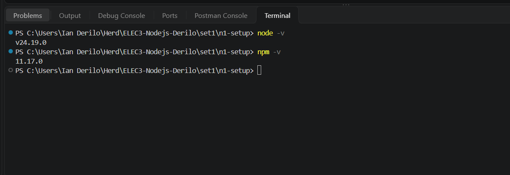
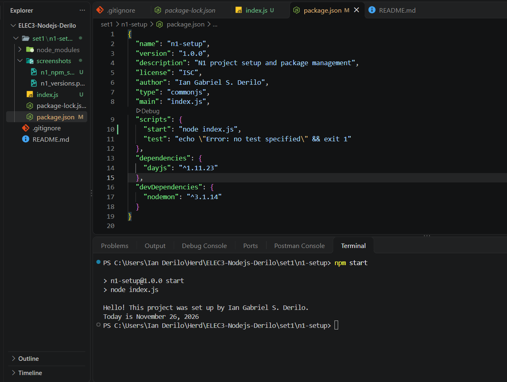
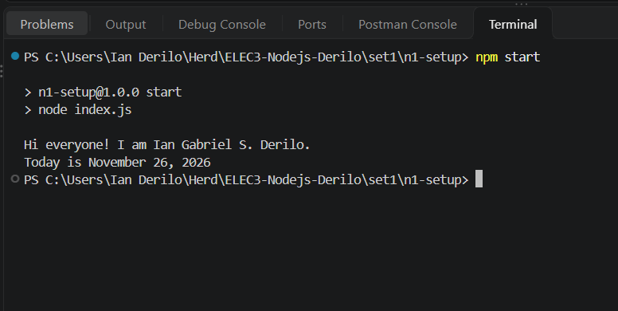
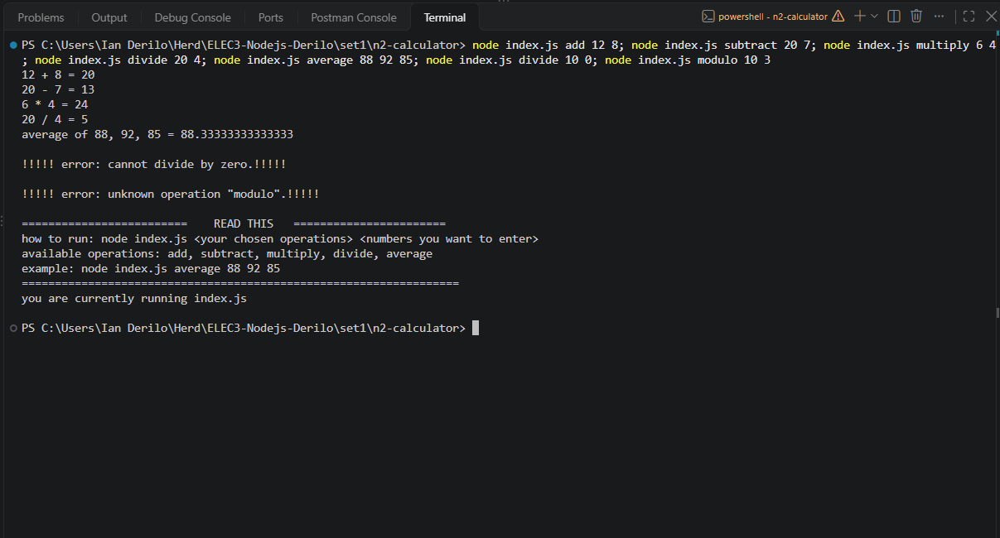
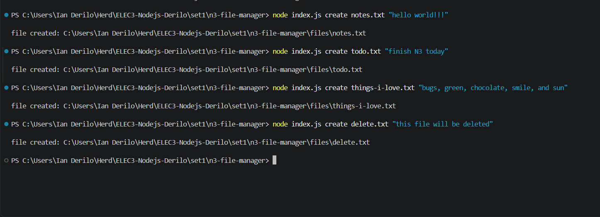
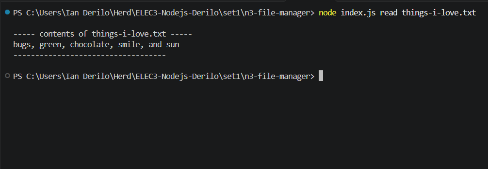
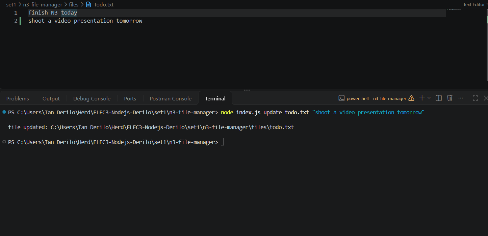
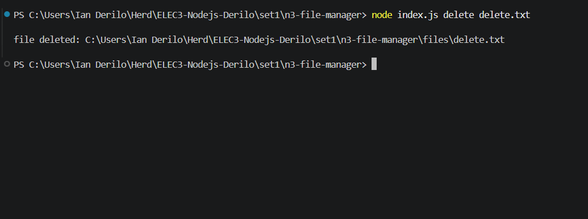
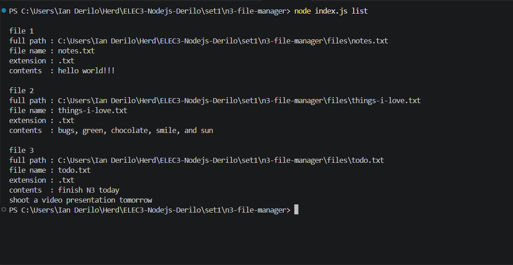

# ELEC 3 – Node.js

- **Name:** Ian Gabriel S. Derilo
- **Section:** IV-BSIT-B
- **Course:** ELEC 3 – Node.js
- **Instructor:** Carl Gustaf Patrik B. Ferrer

## Activities

| Activity | Description | Folder | How to run |
| --- | --- | --- | --- |
| N1: Project Setup and Package Management | Sets up a project with npm, using dayjs as a dependency and nodemon as a dev dependency | [set1/n1-setup](set1/n1-setup) | `cd set1/n1-setup` then `npm install` then `npm start` |
| N2: Modular Calculator | A calculator split into operations and formatter modules that reads the operation and numbers from the command line | [set1/n2-calculator](set1/n2-calculator) | `cd set1/n2-calculator` then `node index.js add 6 9` |
| N3: File Manager with fs and path | Creates, reads, updates, deletes and lists text files inside a files folder | [set1/n3-file-manager](set1/n3-file-manager) | `cd set1/n3-file-manager` then `node index.js create notes.txt "halu mabuhey"` |
| N4: Basic HTTP Server | | | |
| N5: REST-style API | | | |
| N6: Middleware and API Testing | | | |

## Screenshots

### N1: Project Setup and Package Management

### N2: Modular Calculator

### N3: File Manager

